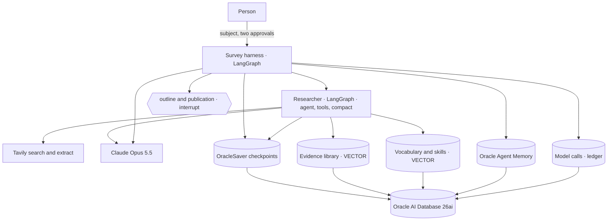

# Part 3 advanced: a deep-research harness

The first half of Part 3 builds one assistant and its harness. This track builds a second
harness for a different kind of work: deep research, where the steps are decided as the
run goes. It writes a survey paper on a subject from pages it finds, reads and cites, on
Oracle AI Database, Claude Opus 5.5 and real web search.

| | |
|---|---|
| Notebook | [`deep_research/notebook/`](deep_research/notebook/): the harness built part by part, 19 parts, with the outputs of a full run saved |
| Appbook | [`deep_research/appbook/`](deep_research/appbook/) on port 8041: one chapter per harness component, each with something to try on its own |
| Sample | [`deep_research/samples/`](deep_research/samples/): a survey on agent harness engineering in which every kept claim has a quote found on the page it cites |

## Quick start

You need Docker running, Python 3.11 or newer, and two keys: `ANTHROPIC_API_KEY` and
`TAVILY_API_KEY`. Run these from the root of the repository.

**1. An environment, once.**

```bash
python3.12 -m venv part_3/advanced/.venv
part_3/advanced/.venv/bin/python -m pip install -r part_3/advanced/requirements.txt
```

**2. The keys.** Put them in a `.env` file at the root of the repository, which Git
ignores, or export them in the shell:

```bash
export ANTHROPIC_API_KEY=...
export TAVILY_API_KEY=...
```

**3a. Start the appbook.**

```bash
part_3/advanced/deep_research/appbook/run.sh
```

Open <http://127.0.0.1:8041>. The first start creates the Oracle AI Database Free
container and loads the embedding model, which takes a few minutes; the page says
*Warming harness* until it is ready. After that a start takes seconds. Begin with
**Reference architecture**, try a chapter's lab (a few cents each), then use
**Write a survey** for a whole paper (about ten minutes and about $6).

**3b. Open the notebook.**

```bash
part_3/advanced/.venv/bin/python -m jupyter lab \
  part_3/advanced/deep_research/notebook/advanced_survey_paper_harness.ipynb
```

The outputs of a full run are saved in it, so it can be read without running anything.
Run from the top to build the harness yourself: Part 2 starts the database, and a full
run takes about sixteen minutes and about $6.70. In VS Code, open the same file and
choose `part_3/advanced/.venv` as the kernel.

The appbook and the notebook use the same database and the same tables, so a paper
written in one can be read in the other.

What the harness has, in the order the notebook builds it:

- a state store, a model gateway that prices every call, and a budget
- an evidence library searched by meaning, with embeddings computed inside the database
- an agreed vocabulary and reading skills, kept in the database and drawn into prompts
- researchers that work with tools (search the web, read a page, load a skill, take a
  note), each one a LangGraph graph of an agent node and a tool node, with limits the
  harness enforces, context offloading and compaction on demand
- a research loop that decides what to research next from what was read
- memory between papers, on Oracle Agent Memory
- sections written from excerpts of the pages, with every cited claim checked for a quote
  found on its page
- a referee, a release check, two approvals by a person, and a run that is cut off and
  continued

## Architecture



The harness has a typed state, plain node functions, checkpoints in Oracle through
`OracleSaver`, `interrupt()` where a person decides, and a JSON schema on every typed
model call so the harness never parses prose. The graph makes one `gather` and one
`write` task per section with `Send`, chooses its follow-up research from what it has
read, and lets a review send back only the sections its budget allows.

## More on the set-up

The appbook's `run.sh` uses `part_3/advanced/.venv` when it exists, and falls back to
`part_3/custom_harness/.venv` and then `part_2/custom_harness/.venv`, which have the same
packages.

**Oracle AI Database.** Oracle AI Database Free runs in Docker as
`ppa-custom-oracle-26ai` on port 1524. The appbook and the notebook each start it when it
is not answering, and create it the first time. The rest of Part 3 uses the same
container. This track creates its own schema, `PPA_ADVANCED`, through the container's operating-system
authentication: `sqlplus / as sysdba` inside the container needs no password. When the
database is not in Docker on the machine, set `ORACLE_ADMIN_PASSWORD`. The ONNX sentence
embedder is loaded into the schema once, so every embedding is computed inside the
database.

**Keys.** `ANTHROPIC_API_KEY` and `TAVILY_API_KEY`, in the shell or the repository `.env`.

## Run the notebook

```bash
part_3/advanced/.venv/bin/python -m jupyter lab \
  part_3/advanced/deep_research/notebook/advanced_survey_paper_harness.ipynb
```

The notebook is segmented by parts and writes its harness out cell by cell. The one thing
it imports is the database setup, from `part_3/_shared/oracle_database.py`, which the
appbook uses too (as `shared.oracle`), so the database is prepared the same way in both.
A full run takes about sixteen minutes and about $6.70. To execute it from the command
line and keep its outputs:

```bash
part_3/advanced/.venv/bin/python part_3/advanced/scripts/execute_notebook.py \
  part_3/advanced/deep_research/notebook/advanced_survey_paper_harness.ipynb
```

**The notebook file is the source.** Nothing generates it: its text, its code, its
diagrams and its saved outputs are all in the `.ipynb`, and you edit it there.

The appbook runs the same harness code as a package (`backend/harness/`), which is a
second copy of what the notebook cells define. When you change a function in one place,
change it in the other. A test compares the two and names any function that has drifted:

```bash
part_3/advanced/.venv/bin/python -m pytest -q part_3/advanced/tests/test_notebooks.py
```

**Diagrams.** Each diagram is an image file in the notebook's `img/` folder, shown by an
`` tag in a markdown cell, with the Mermaid source that draws it under a fold in the
same cell. Because the image is a file, splitting or moving a cell cannot lose it. To
change a diagram, edit the Mermaid text, save the notebook, and redraw:

```bash
npx -y @mermaid-js/mermaid-cli --version      # once, to fetch the Mermaid CLI
python part_3/tools/diagrams/render.py \
  part_3/advanced/deep_research/notebook/advanced_survey_paper_harness.ipynb
```

## Run the appbook

```bash
part_3/advanced/deep_research/appbook/run.sh     # http://127.0.0.1:8041
```

It is one FastAPI process serving a no-build page. **Write a survey** runs a whole paper
with both approvals. Beside it is the **run trace**: the steps of the run with what each
decided, the work of each section side by side, and a log of every step, model call and
tool call as it happens. It opens full screen. A run carries on when you open another
chapter, and a small card in the corner follows it on every page. The chapter list on the
left collapses to a narrow rail. The chapters after it take the harness apart, one component each:
the reference architecture, the database, the state store, the model gateway and the
budget, the evidence store, the vocabulary, the skills, the tools and the researcher's
graph, context management, the research loop, memory, the planner, the writer and
verifier, the quality gate, the graph, human approval, durability, the ledger and the
paper. Each chapter says what the component is for and has something to run on its own.

Chapter 1 is the **reference architecture** of the running application: every component
with its name and technology, and every data flow between them. Select a component to
read what it does. **Simulate a run** plays one execution across the diagram step by
step. The diagram and the player are
[`frontend/shared/refarch.js`](deep_research/appbook/frontend/shared/refarch.js); the
appbook describes its own architecture as data in `frontend/refarch-spec.js`.

## Verify

```bash
part_3/advanced/.venv/bin/python -m pytest -q part_3/advanced/tests
```

The suite is offline. It checks the routing rules of the graph, the researcher's graph
and its limits, the rule that one work is stored once, the quote check, the claim
removal, the budget grant and the release check, and the shape and hygiene of the
notebook (parts, images, no long cells, no secrets, no errors in saved outputs, code in
step with the appbook).

Two scripts write a survey from the command line, approving both gates, and continue one
from its last checkpoint:

```bash
part_3/advanced/.venv/bin/python part_3/advanced/scripts/survey_run.py "agent harness engineering"
part_3/advanced/.venv/bin/python part_3/advanced/scripts/survey_continue.py <paper_id>
```

`scripts/check_notebook_names.py <notebook>` is a static check worth running before the
notebook is executed: it lists every name a code cell uses without an earlier cell
defining or importing it.

## What is honest about the results

The survey paper is written by a model from pages found on the web that day. It is
well-shaped, cited and traceable, not peer-reviewed, and its last section says so. Its
claim check proves a quoted passage is on the cited page and that a model judged the
passage to carry the claim. It does not prove the page is right. In the saved run the
referee asked for a revision that the budget could not pay for, and the paper says what
the referee found missing.
